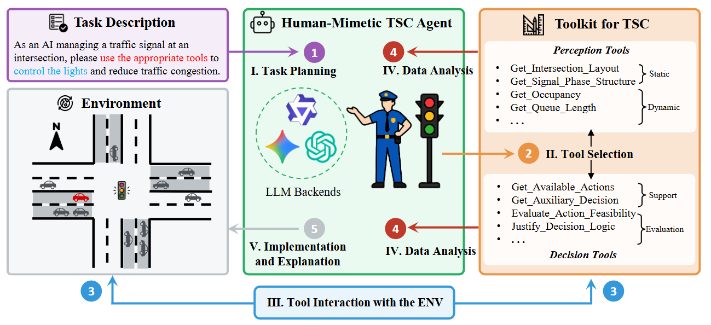
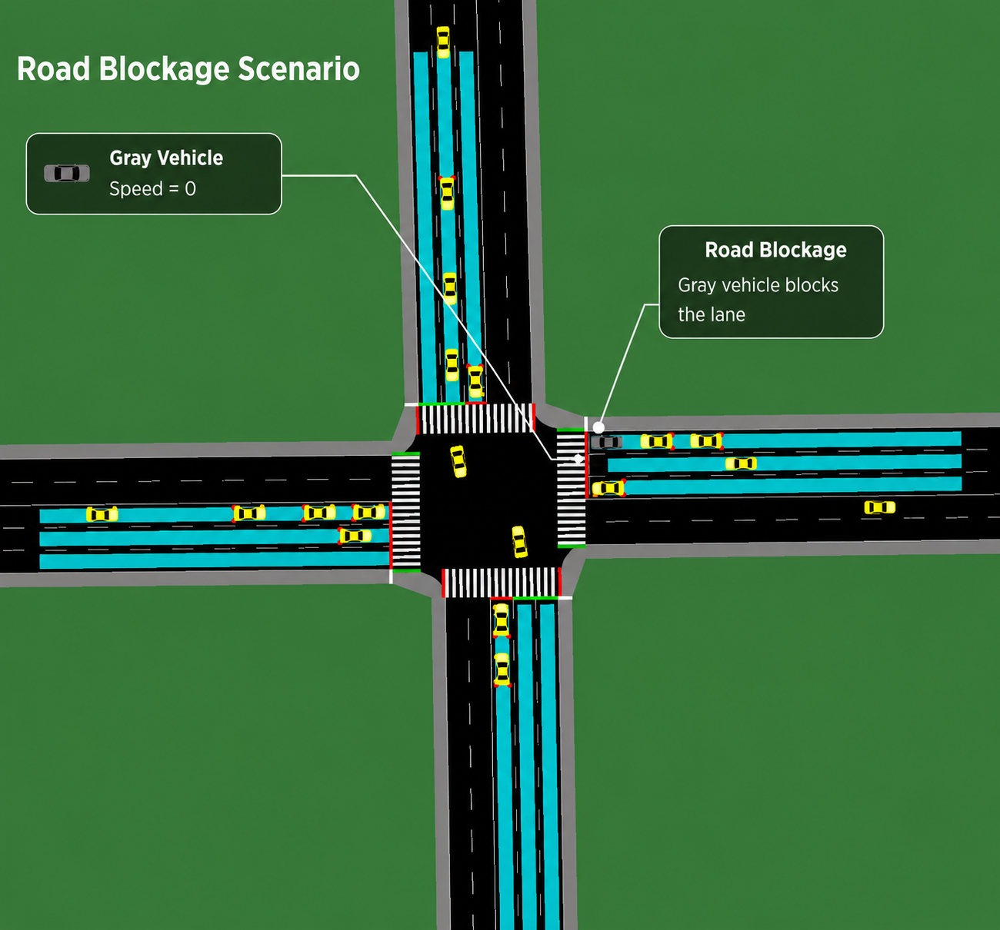
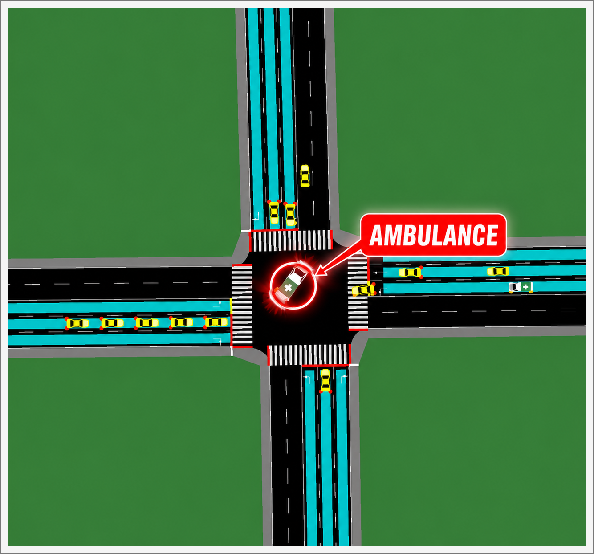

<!--
 * @Author: WANG Maonan
 * @Date: 2023-09-15 16:46:26
 * @Description: LA-Light README
 * @LastEditTime: 2026-10-13 21:58:54
-->
# 🚦 LLM-Assisted Light (LA-Light)

[](https://arxiv.org/abs/2403.08337)
[](https://opensource.org/licenses/Apache-2.0)
[](https://www.python.org/downloads/)


Official implementation of [LLM-Assisted Light: Augmenting Traffic Signal Control with Large Language Model in Complex Urban Scenarios](https://arxiv.org/abs/2403.08337).

## 📢 Latest News
- **[October 2026]** 🔧 **Code refactor**: Consolidated code under `la_light/`, split the LLM agent by function, and unified the simulation environment across controllers.
- **[September 2026]** 🎉 **OmniTraffic accepted at NeurIPS 2026 ED Track!** Congratulations! Our **spatio-temporal traffic dataset** incorporates road network information to assess the traffic understanding and reasoning capabilities of multimodal large language models (MLLMs). [Paper Link](https://arxiv.org/pdf/2606.15749)
- **[May 2026]** **Introducing [OmniTraffic Benchmark](https://huggingface.co/datasets/CROHuang/OmniTraffic_Benchmark) and [OmniTraffic Dataset](https://huggingface.co/datasets/CROHuang/Omnitraffic_Dataset)**: Covering **12 reconstructed real-world intersections**, OmniTraffic provides **8M generated VQA samples** for training MLLMs and **3K human-verified test samples** for evaluating traffic scene understanding, spatio-temporal reasoning, and decision support capabilities.
- **[June 2026]** 🔧 **Codebase refresh**: dynamic special events (accidents, special vehicles, sensor failures) are now loaded from a YAML config (`--event-config`) instead of being hard-coded; the LLM agent no longer depends on LangChain (lightweight OpenAI-based ReAct); and static intersection info (layout, phase structure, available actions) is injected into the prompt once per episode, simplifying tool calls to dynamic state only.
- **[September 2025]** 🎉 **VLMLight accepted at NeurIPS 2025!** Congratulations! Our VLM-based traffic signal control paper has been accepted at NeurIPS 2025. [Paper Link](https://proceedings.neurips.cc/paper_files/paper/2025/hash/3849b5861dcaeaf4758eef0979a98cc6-Abstract-Conference.html)
- **[July 2025]** **Introducing [VLMLight](https://github.com/Traffic-Alpha/VLMLight)**: Our next-generation framework featuring **image-based traffic signal control** using Vision-Language Models (VLMs) for enhanced scene understanding and real-time decision-making.
- **[March 2024]** **Introducing [LLM-Assisted Light](https://arxiv.org/abs/2403.08337)**: Our framework combines **LLM reasoning with perception and decision-making tools** to mimic how traffic police manage complex intersections.
- **[August 2023]** We have migrated the simulation platform used in this project from Aiolos to [TransSimHub](https://github.com/Traffic-Alpha/TransSimHub) (TSHub). We would like to express our sincere gratitude to our colleagues at SenseTime, **@KanYuheng (阚宇衡)**, **@MaZian (马子安)**, and **@XuChengcheng (徐承成)** (in alphabetical order) for their valuable contributions. The development of TransSimHub (TSHub) is a continuation of the work done on Aiolos.


## 🧩 Core Framework of LLM-Assisted Light

Five-stage hybrid decision-making for human-AI collaborative traffic control:
1. **Task Planning**: LLM defines traffic management role
2. **Tool Selection**: Dynamically invokes perception & decision tools
3. **Environment Interaction**: Real-time traffic data collection
4. **Data Analysis**: Decision unit generates control strategies
5. **Execution Feedback**: Implements decisions with explainable justifications

<div align=center>
  
</div>

## 🌐 Complex Urban Scenarios

LA-Light is built for **dynamic special events** in urban traffic:

- **`ACCIDENTS`** — a lane is blocked (simulated with a stopped vehicle)
- **`SPECIAL_VEHICLES`** — emergency vehicles need priority
- **`SENSOR_FAILURES`** — occupancy readings are masked

<div align="center">
  
  
</div>
<p align="center">
  <strong>Left — Road blockage (<code>ACCIDENTS</code>)</strong> &nbsp;·&nbsp; <strong>Right — Special vehicle (<code>SPECIAL_VEHICLES</code>)</strong>
</p>

Events are declared in YAML and injected via `--event-config`; see [Event-Aware Evaluation](#-event-aware-evaluation).

## 🚀 Getting Started with LA-Light

LA-Light runs on 3-way and 4-way intersections in TSHub/SUMO. The LLM acts as a traffic officer, combining MP expert advice with live observations and traffic tools to handle special events.

### 🛠️ Installation

Install [TransSimHub](https://github.com/Traffic-Alpha/TransSimHub):

```bash
git clone https://github.com/Traffic-Alpha/LLM-Assisted-Light.git
git clone https://github.com/Traffic-Alpha/TransSimHub.git
cd TransSimHub
pip install -e ".[all]"
cd ../LLM-Assisted-Light
pip install openai httpx pyyaml loguru
```

Copy and edit the local configuration file:

```bash
cp config.yaml.example config.yaml
```

Set the API key, model, and endpoint in `config.yaml`, or select another model configuration with `--config <model.yaml>`. A DeepSeek non-thinking example is provided in `deepseek_config.yaml.example`.

### 🤖 LLM-Assisted Traffic Signal Control

Run the LLM-based traffic signal controller:

```bash
python run_llm_tsc.py \
  --scenario 4way \
  --event-config scenarios/4way/events/special_vehicles_accident.yaml \
  --decision-log /tmp/llm_decision.jsonl \
  --episode-summary /tmp/llm_episode.json
```

The agent receives intersection context, live observations, and MP expert advice. It chooses which traffic tools to query and whether to follow or adjust the recommendation. The logs capture decisions, tool calls, and latency.

### 📊 Max-Pressure Baseline

Run the max-pressure baseline on the same scenario and event configuration:

```bash
python run_maxpressure.py \
  --scenario 4way \
  --event-config scenarios/4way/events/special_vehicles_accident.yaml \
  --decision-log /tmp/maxpressure_decision.jsonl
```

MP follows the same expert recommendation supplied to LA-Light. Both controllers share the TSHub/SUMO environment in `la_light/env/`; the modular agent is in `la_light/llm/`. Episodes run until traffic and pending events finish, with teleport disabled by default.

### 🚑 Event-Aware Evaluation

Both road networks provide special vehicles, special vehicles with accidents, and special vehicles with sensor failures through YAML files under `scenarios/<scenario>/events/`. For 3-way experiments, use `--scenario 3way` and the matching event file. Signal phases are inferred from the road network.

Compare tripinfo results, including both regular traffic and special-vehicle efficiency:

```bash
python analyze_tsc_results.py \
  llm:4way_llm_tsc.tripinfo.xml \
  maxpressure:4way_maxpressure.tripinfo.xml \
  --event-config scenarios/4way/events/special_vehicles_accident.yaml \
  --output /tmp/traffic_comparison.json
```

The report compares travel time, waiting time, and completion counts for ordinary and special vehicles separately. Travel and waiting averages cover completed trips; `--event-config` excludes accident obstacles. See [event configuration details](docs/event_config.md) for custom scenarios.

## 🎥 LA-Light Joint Decision-Making Demo

The following video shows the original LA-Light decision-making process. Each decision involves multiple tool invocations and subsequent reasoning based on tool-returned observations, culminating in a final decision and explanation.

[LLM_for_TSC_README.webm](https://github.com/Traffic-Alpha/LLM-Assisted-Light/assets/21176109/131281d9-831d-4e08-919c-2ee8ac3fd841)

Due to the video length limit, we only captured part of the first decision-making process, including:

- Action 1: Obtaining the intersection layout, the number of lanes, and lane functions (turn left, go straight, or turn right) for each edge.
- Action 3: Obtaining the occupancy of each edge. The -E3 straight line has a higher occupancy rate, corresponding to the simulation. At this point, LA-Light can use tools to obtain real-time road network information.
- Final Decision and Explanation: Based on a series of results, LA-Light provides the final decision and explanation.

## 🎥 Scenario Demos

[Scenario_1](https://github.com/Traffic-Alpha/LLM-Assisted-Light/assets/21176109/3075d18c-a6eb-4b5c-bdc9-f79936e13dc2)
<p align="center">Examples of LA-Lights Utilizing Tools to Control Traffic Signals <strong>(Normal Scenario)</strong></p>

[Scenario_2](https://github.com/Traffic-Alpha/LLM-Assisted-Light/assets/21176109/9062f888-314d-43f8-b668-9ad46471504c)
<p align="center">Examples of LA-Lights Utilizing Tools to Control Traffic Signals <strong>(Emergency Vehicle (EMV) Scenario)</strong></p>

## 📜 Citation

If you find our work useful in your research, we would be grateful if you could cite our papers:

```bibtex
@article{wang2024llm,
  title={LLM-Assisted Light: Leveraging Large Language Model Capabilities for Human-Mimetic Traffic Signal Control in Complex Urban Environments},
  author={Wang, Maonan and Pang, Aoyu and Kan, Yuheng and Pun, Man-On and Chen, Chung Shue and Huang, Bo},
  journal={arXiv preprint arXiv:2403.08337},
  year={2024}
}

@inproceedings{wang2025vlmlight,
 author = {Wang, Maonan and Chen, Yirong and Pang, Aoyu and Cai, Yuxin and Chen, Chung Shue and Kan, Yuheng and Pun, Man On},
 booktitle = {Advances in Neural Information Processing Systems},
 editor = {D. Belgrave and C. Zhang and H. Lin and R. Pascanu and P. Koniusz and M. Ghassemi and N. Chen},
 pages = {39590--39621},
 publisher = {Curran Associates, Inc.},
 title = {{VLMLight}: Safety-Critical Traffic Signal Control via Vision-Language Meta-Control and Dual-Branch Reasoning Architecture},
 url = {https://proceedings.neurips.cc/paper_files/paper/2025/file/3849b5861dcaeaf4758eef0979a98cc6-Paper-Conference.pdf},
 volume = {38},
 year = {2025}
}

@ARTICLE{pang2026illmtsc,
  author={Pang, Aoyu and Wang, Maonan and Pun, Man-On and Chen, Chung Shue and Xiong, Xi},
  journal={IEEE Transactions on Vehicular Technology}, 
  title={iLLM-TSC: Integration Reinforcement Learning and Large Language Model for Traffic Signal Control Policy Improvement}, 
  year={2026},
  volume={75},
  number={8},
  pages={15762-15776},
  doi={10.1109/TVT.2026.3674284}
}
```

You may also be interested in our earlier work on RL-based traffic signal control (TSC):

```bibtex
@ARTICLE{wang2024unitsa,
  author={Wang, Maonan and Xiong, Xi and Kan, Yuheng and Xu, Chengcheng and Pun, Man-On},
  journal={IEEE Transactions on Vehicular Technology}, 
  title={UniTSA: A Universal Reinforcement Learning Framework for V2X Traffic Signal Control}, 
  year={2024},
  volume={73},
  number={10},
  pages={14354-14369},
  doi={10.1109/TVT.2024.3403879}
}

@ARTICLE{wang2024ccda,
  author={Wang, Maonan and Chen, Yirong and Kan, Yuheng and Xu, Chengcheng and Lepech, Michael and Pun, Man-On and Xiong, Xi},
  journal={IEEE Transactions on Intelligent Transportation Systems}, 
  title={Traffic Signal Cycle Control With Centralized Critic and Decentralized Actors Under Varying Intervention Frequencies}, 
  year={2024},
  volume={25},
  number={12},
  pages={20085-20104},
  doi={10.1109/TITS.2024.3462153}
}

@ARTICLE{pang2024delaytsc,
  author={Pang, Aoyu and Wang, Maonan and Chen, Yirong and Pun, Man-On and Lepech, Michael},
  journal={IEEE Open Journal of Vehicular Technology}, 
  title={Scalable Reinforcement Learning Framework for Traffic Signal Control Under Communication Delays}, 
  year={2024},
  volume={5},
  pages={330-343},
  doi={10.1109/OJVT.2024.3368693}
}
```

## 🤝 Open-Source Foundations

This project stands on the shoulders of these open-source giants:
- [TransSimHub](https://github.com/Traffic-Alpha/TransSimHub)
- [LangChain](https://github.com/hwchase17/langchain)
- [stable-baselines3](https://github.com/DLR-RM/stable-baselines3)

## 📮 Contact

If you have any questions, please report issues on GitHub.
